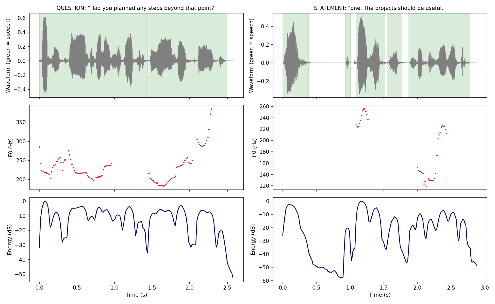
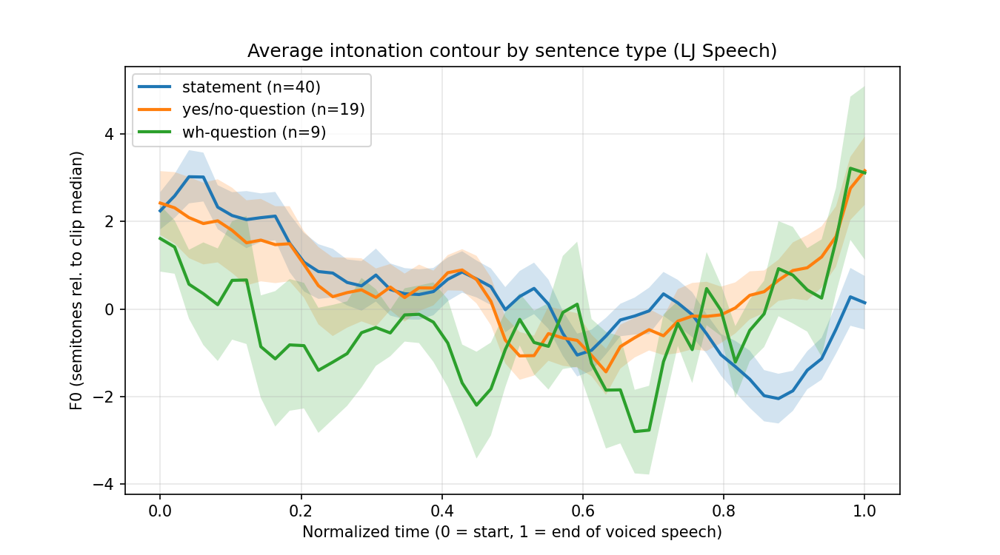

# Prosody Feature Extractor & Intonation Visualizer

A small Python pipeline that extracts prosodic features (pitch, energy, pauses, speaking rate) from speech and visualizes how intonation differs between statements and questions.

## Dataset
[LJ Speech](https://keithito.com/LJ-Speech-Dataset/): about 13,100 clips of one English speaker reading audiobooks. Transcript punctuation gives free labels: sentences ending in `?` are questions and sentences ending in `.` are statements. Only clips of 4-15 words are used. Questions are further split into yes/no and wh-questions by their first word.

## Method
- **F0 (pitch):** `librosa.pyin` (70-400 Hz, 16 ms hop). pYIN handles unvoiced frames well and returns NaN where there is no pitch.
- **Speaker-independent pitch:** F0 is converted to semitones relative to the clip's median, then median-filtered (window 5) to remove octave-jump errors.
- **Energy:** RMS converted to dB.
- **Pauses and rate:** silence-based speech segmentation (`librosa.effects.split`); gaps of 150 ms or more count as pauses; speaking and articulation rate in words per second.
- **Average contours:** voiced pitch is time-normalized to 0-1 and averaged across clips (mean ± standard error).

## Results

### Single-clip comparison


In the example question ("Had you planned any steps beyond that point?"), F0 rises sharply at the end of the utterance, from roughly 290 Hz to about 380 Hz. The statement example has sparse voiced frames, which shows a limitation of pitch tracking on short or partly silent clips.

### Average intonation contour by sentence type


| Group | n clips |
|---|---|
| statement | 40 |
| yes/no question | 19 |
| wh-question | 9 |

- Yes/no questions show a clear final rise of about +3 semitones above the clip median.
- Statements dip towards about -2 semitones near the end and then recover to roughly the median.
- Wh-questions also end high, but n = 9 and the confidence band is very wide, so no conclusion is drawn about them.

## Limitations
- One speaker reading audiobooks, so this is not conversational or multi-speaker speech.
- Small samples (especially wh-questions), so the average curves are indicative, not conclusive.
- Pitch tracking has gaps in unvoiced regions and can make errors.

## Run it
Open `Project_B_Prosody_Classifier.ipynb` in Google Colab (CPU runtime). It downloads LJ Speech and runs end to end.

```
pip install librosa soundfile seaborn
```

## Possible next steps
Extend the same pipeline to Tamil/Hindi speech data, and compare pYIN with Praat/Parselmouth F0 estimates.
